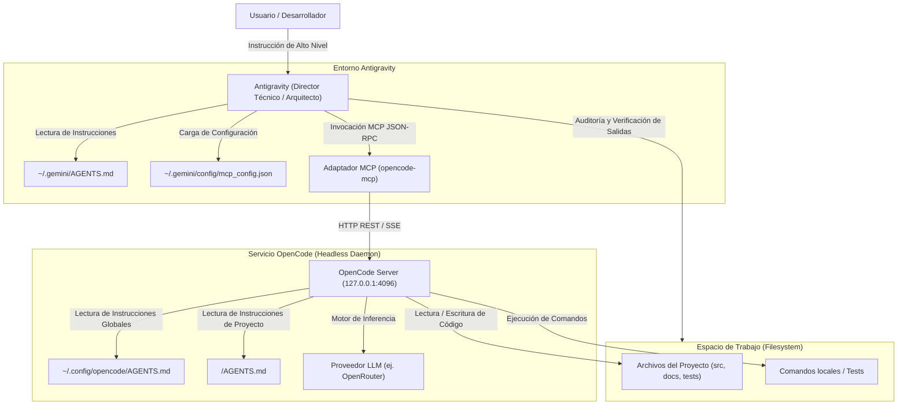
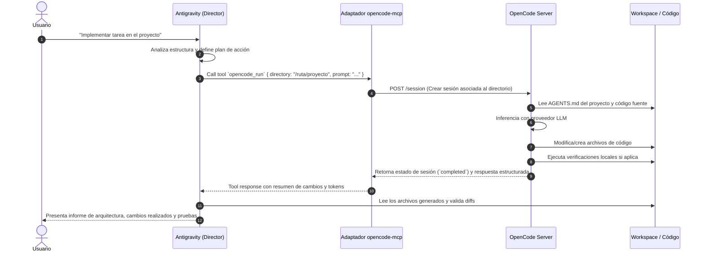

# Arquitectura del Sistema: Integración Antigravity + OpenCode vía MCP

Este documento describe la arquitectura técnica, los componentes del sistema, el modelo de comunicación y las fronteras de responsabilidad entre **Antigravity** y **OpenCode** a través del protocolo **Model Context Protocol (MCP)**.

---

## 1. Visión General de la Arquitectura

El diseño separa la fase de **análisis, orquestación y control de calidad** de la fase de **ejecución e implementación de código**. La integración se apoya en un patrón de cliente-servidor distribuido localmente:



---

## 2. Definición y Límites de los Agentes (Harnesses)

### 2.1 Antigravity (Harness de Dirección Técnica)
- **Naturaleza**: Agente conversacional e interactivo con capacidades analíticas avanzadas.
- **Entorno de ejecución**: Opera dentro del entorno Antigravity con acceso al sistema de archivos, navegación web, terminal y cliente MCP nativo.
- **Fronteras y rol**:
  - Aunque Antigravity dispone de herramientas para crear y editar archivos, se le asigna mediante instrucciones en `AGENTS.md` el rol de **no modificar código fuente directamente**.
  - Su misión se concentra en analizar requerimientos, auditar el estado del repositorio, estructurar planes de implementación atómicos, delegar las tareas de código a OpenCode y auditar los resultados.

### 2.2 OpenCode (Harness de Implementación de Código)
- **Naturaleza**: Asistente de programación optimizado para edición de archivos, análisis sintáctico (LSP) y ejecución de pruebas en workspace.
- **Entorno de ejecución**: Servicio daemon headless (`opencode serve`) ejecutado en la interfaz local (`127.0.0.1:4096`).
- **Fronteras y rol**:
  - Recibe tareas puntuales vía API con contexto explícito del proyecto (`directory`).
  - Consulta y respeta la jerarquía de directivas de `AGENTS.md`.
  - Modifica código respetando las convenciones del lenguaje y del proyecto.
  - Ejecuta pruebas y comprobaciones antes de reportar la tarea como finalizada.

---

## 3. El Protocolo MCP (Model Context Protocol)

El **Model Context Protocol (MCP)** es un estándar abierto para estandarizar la interacción entre modelos de IA y herramientas externas.

### 3.1 Características clave en esta integración:
- **Transporte STDIO**: Antigravity lanza el adaptador `opencode-mcp` como un subproceso local e interactúa con él a través de flujos estándar `stdin` / `stdout` utilizando tramas JSON-RPC 2.0.
- **Descubrimiento de Herramientas**: Antigravity consulta las herramientas expuestas por el servidor al inicializar la sesión (`tools/list`). En la sesión verificada con `opencode-mcp@3.0.0`, Antigravity detectó **87 herramientas** bajo el prefijo `opencode_`. Este número refleja el catálogo expuesto por esa versión específica y no debe asumirse como un requisito permanente.
- **Persistencia de Tareas Asíncronas**: Los trabajos complejos se despachan mediante identificadores únicos (`jobId`), lo que permite que tareas prolongadas se ejecuten de manera auditable sin bloquear la interacción del usuario.

---

## 4. El Adaptador `opencode-mcp`

El componente `opencode-mcp` actúa como pasarela (*bridge*) entre la especificación de herramientas MCP y la API REST/SSE de OpenCode.

### 4.1 Responsabilidades del Adaptador:
1. **Exposición de Esquemas de Herramientas**: Convierte los endpoints de la API de OpenCode en herramientas con esquemas tipados JSON Schema (Zod).
2. **Traducción de Parámetros**: Mapea los parámetros de las herramientas MCP (`directory`, `prompt`, `providerID`, `modelID`) a las sesiones de OpenCode.
3. **Gestión del Almacén de Trabajos (*Task Store*)**: Almacena el historial y los metadatos de los trabajos locales en:
   ```text
   ~/.local/state/opencode-mcp/tasks/<hash_directorio>/job_<job_id>.json
   ```
4. **Control de Flujo de Entrada Requerida**: Gestiona situaciones en las que OpenCode solicita decisiones o permisos del usuario (`status: input_required`).

### 4.2 Herramientas Principales Utilizadas:

| Herramienta MCP | Tipo | Propósito |
|---|---|---|
| `opencode_health` | Diagnóstico | Consulta el estado del servidor OpenCode (vía `/global/health`). |
| `opencode_setup` | Inicialización | Descubre configuraciones, proveedores y modelos disponibles. |
| `opencode_run` | Ejecución Síncrona / Observada | Inicia una tarea de implementación y espera activamente su resultado. |
| `opencode_fire` | Ejecución Asíncrona | Inicia una tarea en segundo plano y retorna de inmediato el `jobId`. |
| `opencode_check` | Sondeo | Consulta el estado actual de un trabajo asíncrono lanzado con `opencode_fire`. |
| `opencode_ask` | Consulta Rápida | Envía un mensaje puntual dentro de una sesión acotada. |
| `opencode_review_changes` | Auditoría | Inspecciona el diff de archivos generado durante una sesión. |

---

## 5. Flujo de Comunicación Extremo a Extremo



---

## 6. Seguridad del Servidor y Consideraciones de Red

Al ejecutar el servidor con `opencode serve --hostname 127.0.0.1 --port 4096`, el proceso emite la siguiente advertencia en consola:

```text
Warning: OPENCODE_SERVER_PASSWORD is not set; server is unsecured.
opencode server listening on http://127.0.0.1:4096
```

### Análisis de seguridad del entorno:
- **Aislamiento por Loopback**: Escuchar en `127.0.0.1` restringe el acceso a conexiones originadas en la misma máquina física, bloqueando peticiones desde la red externa o LAN.
- **Límites de protección**: La vinculación a loopback **no** previene que otros procesos o usuarios locales en el mismo sistema operativo interactúen con el puerto HTTP sin autenticación. En entornos compartidos o multi-usuario, se recomienda configurar `OPENCODE_SERVER_PASSWORD` tanto en el arranque del servidor como en las variables de entorno de `mcp_config.json`.

---

## 7. Jerarquía de Directivas de Agentes (`AGENTS.md`)

Las directivas de comportamiento operan en tres niveles complementarios:

1. **Nivel 1: Directivas Globales de Antigravity (`~/.gemini/AGENTS.md`)**:
   - Instruyen a Antigravity a delegar la implementación de código a OpenCode mediante MCP.
   - Establecen la obligación de utilizar rutas absolutas en las tareas delegadas.
2. **Nivel 2: Directivas Globales de OpenCode (`~/.config/opencode/AGENTS.md`)**:
   - Indican a OpenCode que confirme el directorio asignado y consulte el `AGENTS.md` local.
   - Prohíben operaciones destructivas, commits automáticos y modificaciones fuera de scope.
3. **Nivel 3: Directivas de Proyecto (`<workspace>/AGENTS.md`)**:
   - Definen las reglas particulares del repositorio (estándares de código, tests requeridos).

---

## 8. Referencias Oficiales Consultadas

- [OpenCode Docs](https://opencode.ai/docs/)
- [OpenCode Server Reference](https://opencode.ai/docs/server/)
- [Model Context Protocol Specification](https://modelcontextprotocol.io/)
- [opencode-mcp GitHub Repository](https://github.com/AlaeddineMessadi/opencode-mcp)
